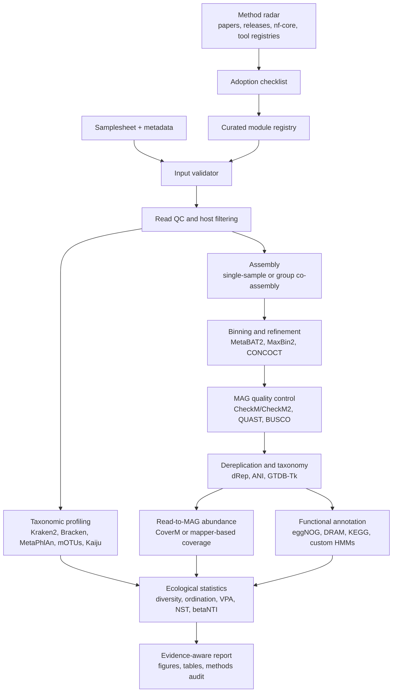

# Automated Metagenome Pipeline

一个面向公共复用的全自动宏基因组分析平台：把成熟流程、顶刊常用分析、方法雷达、质量审计和可解释报告放到同一套入口里。目标不是替代 `nf-core/mag` 或 `nf-core/taxprofiler`，而是在它们之上补齐“从原始数据到论文级结果”的自动决策、检查和持续更新能力。

## Why This Exists

很多宏基因组流程能跑，但使用者仍然要自己判断：

- 样本表、数据库、宿主过滤、共组装分组是否合理。
- 应该选择哪些分类、binning、MAG QC、功能注释和丰度工具。
- 新的顶刊方法或工具是否值得纳入流程。
- 哪些结果能支持机制解释，哪些只能说是功能潜力或相关性。
- 最终报告是否足够透明，别人能否快速复现。

这个项目把这些判断做成可检查的自动化模块，让新用户能更快上手，让高级用户能保留可追踪、可升级、可审计的分析路径。

## Main Workflow



## What Makes It More Automatic

- One command validates samplesheets, database paths, output structure and expected modules.
- Project parameters live in `config/project.yaml`; pipeline-specific parameters live in focused files.
- `method_radar` scans curated sources and writes an update report instead of relying on memory.
- `methods_audit` checks whether expected result layers exist before interpretation.
- Evidence guardrails are built into the report: abundance, taxonomy, MAG gene content and environmental correlations are kept as separate evidence layers.
- The design is domain-neutral: human gut, soil, sediment, marine, plant-associated, engineered systems and host-associated metagenomes can use the same backbone.

## Quick Start

```bash
git clone https://github.com/rsuag/automated-metagenome-pipeline.git
cd automated-metagenome-pipeline

make validate
make radar
make run-taxonomy
make run-mag
make summarize
```

For a full run:

```bash
make all
```

Before real analysis, edit:

- `config/project.yaml`
- `config/samplesheet_mag.csv`
- `config/samplesheet_taxprofiler.csv`
- `config/databases_taxprofiler.csv`
- `config/params_mag.yml`
- `config/params_taxprofiler.yml`

## Modules

| Layer | Default strategy | Reliability check |
| --- | --- | --- |
| Read QC | FastQC/MultiQC plus short-read QC | fail early on missing reads or wrong file shape |
| Decontamination | host/PhiX/custom reference filtering | require explicit reference paths |
| Taxonomy | multi-tool profiling | compare marker-based and k-mer-based profiles |
| Assembly | single-sample or group co-assembly | group must be declared in samplesheet |
| Binning | multiple binners plus refinement | report bin origin and refinement status |
| MAG QC | completeness, contamination, N50, contig count | separate high-quality and medium-quality MAGs |
| Taxonomy | GTDB-Tk/CAT-style classification | preserve database version in report |
| Dereplication | dRep/ANI | keep representative genome and cluster map |
| Abundance | reads-to-contigs/MAG mapping | report coverage, breadth and normalized abundance |
| Function | general and custom databases | distinguish gene presence, pathway completeness and measured activity |
| Ecology | ordination, variance partitioning, null models | require metadata and multiple-testing notes |
| Reporting | audit-first summary | flag missing layers before biological interpretation |

## Method Radar

The radar is a lightweight way to keep the project current without blindly chasing every new tool.

```bash
make radar
```

It reads `config/method_sources.json`, checks curated sources when network is available, and writes:

```text
results/report/method_radar.md
```

New methods are not automatically promoted to defaults. They pass through this checklist:

1. Does it solve a real bottleneck compared with the current module?
2. Is it maintained, documented and reproducible in containers or conda?
3. Does it expose outputs that can be audited automatically?
4. Can it coexist with current defaults without breaking old projects?
5. Does it improve accuracy, speed, interpretability or scope enough to justify adoption?

## Top-Journal Analysis Extensions

The default backbone can be extended with modules often seen in strong microbiome and metagenome papers:

- Strain-resolved profiling and population genetics.
- Viral, plasmid, ARG and mobile genetic element analysis.
- Genome-resolved metabolic reconstruction.
- Long-read or hybrid assembly.
- MAG abundance, prevalence and niche breadth.
- Environmental association, variance partitioning and distance-decay.
- Null-model community assembly analysis.
- Custom marker HMMs for nitrogen, carbon, sulfur, phosphorus, methane, antibiotic resistance or host-specific pathways.

## Interpretation Rules

- MAG gene presence supports metabolic potential, not direct activity.
- Gene absence in incomplete MAGs should be reported as not detected, not true pathway loss.
- Taxonomic profiles, read mapping, MAG content and environmental correlations should not be collapsed into one causal claim.
- Process claims need process measurements, transcriptomics, proteomics, stable isotope data or controlled validation.

## Repository Layout

```text
.
├── bin/                         # pipeline launchers
├── config/                      # project, samplesheet, database and radar configs
├── docs/                        # method blueprint and reliability model
├── scripts/                     # validators, radar and reporting utilities
├── Makefile                     # common entry points
└── README.md                    # GitHub landing page
```

## Current Status

This is an automation scaffold plus reliability layer. It is ready for real project paths and database paths, but the first public release intentionally keeps compute-heavy outputs out of the repository.

